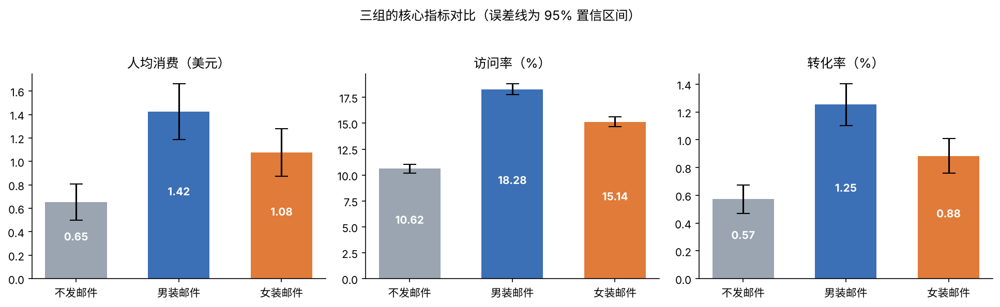
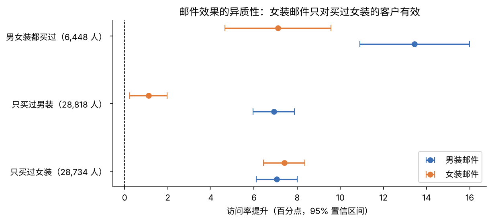
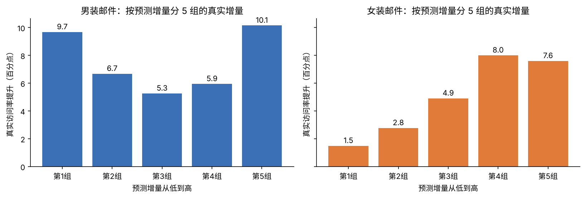
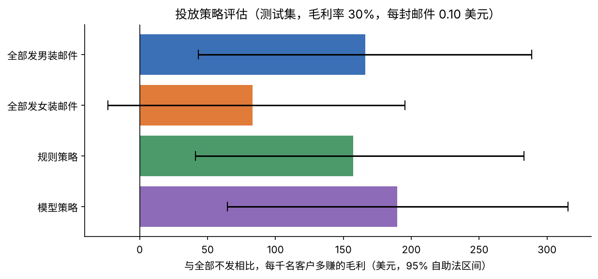

# 邮件营销实验分析：发什么邮件、发给谁、值不值得发？

基于 64,000 名客户的三组随机实验（男装邮件、女装邮件、不发邮件），从实验质量检查、主效应检验，到方差缩减、异质性分析、增量建模和投放决策，完整回答"邮件营销该怎么做"。

**技术栈：** Python（pandas、SciPy、statsmodels、scikit-learn）· 两样本比例 Z 检验 · 韦尔奇 t 检验 · 自助法 · Holm 校正 · CUPED 与回归调整 · 交互项回归 · T-Learner 增量模型 · 逆概率加权策略评估

## 结论速览

- **两种邮件都有效，男装邮件更好：** 男装邮件让人均消费从 0.65 美元提升到 1.42 美元（**+118%**），访问率提升 **7.7 个百分点**；女装邮件人均消费提升 65%，访问率提升 4.5 个百分点。9 项检验经 Holm 校正后全部显著
- **女装邮件只对买过女装的客户有效：** 对只买过男装的客户，女装邮件的访问率提升只有 1.1 个百分点，而对买过女装的客户约 7 个百分点；交互项回归 P = 2.8 × 10⁻²²。男装邮件对各类客户都有效，对男女装都买过的客户效果最强（13.4 个百分点）
- **方差缩减效果有限：** 实验前特征和实验期行为相关性很弱，回归调整最多只缩减约 3% 的方差，说明方差缩减的效果取决于协变量的预测力
- **投放建议：** 在假设毛利率 30%、每封邮件成本 0.10 美元下，全部发男装邮件比不发每千名客户多赚 **166 美元**（95% 区间 43 至 289 美元）。基于增量模型的个性化策略多赚 190 美元，但与"全部发男装"的差距在统计上不显著，**建议默认全部发男装邮件，个性化策略先小流量实验验证再推广**

## 实验设计

| 组别 | 人数 | 占比 |
|---|---|---|
| 不发邮件（对照组） | 21,306 | 33.3% |
| 男装邮件 | 21,307 | 33.3% |
| 女装邮件 | 21,387 | 33.4% |

| 类型 | 指标 |
|---|---|
| 核心指标 | 人均消费（两周内） |
| 次要指标 | 访问率、转化率 |
| 实验前特征 | 距上次购买月数、过去一年消费、是否买过男装或女装、是否新客、地区类型、购买渠道 |

## 分析过程

### 1. 实验质量检查

- **分流检查：** 三组人数卡方检验 P = 0.904，分流正常
- **协变量平衡：** 所有实验前特征的标准化均值差绝对值不超过 0.014（远小于 0.1 的阈值），随机分组成功
- **数据特点：** 只有 0.9% 的客户下单，人均消费 99% 以上为 0，因此消费指标同时用韦尔奇 t 检验和自助法验证

### 2. 主效应

| 对比 | 人均消费 | 访问率 | 转化率 |
|---|---|---|---|
| 男装邮件 vs 不发 | **+0.77 美元（+118%）** | **+7.66 个百分点（+72%）** | +0.68 个百分点（+119%） |
| 女装邮件 vs 不发 | +0.42 美元（+65%） | +4.52 个百分点（+43%） | +0.31 个百分点（+54%） |
| 男装邮件 vs 女装邮件 | +0.35 美元（+32%） | +3.14 个百分点（+21%） | +0.37 个百分点（+42%） |

共 9 次检验，Holm 校正后全部显著（P 均 < 0.05）。



### 3. 方差缩减

| 对比 | 指标 | CUPED 方差缩减 | 回归调整方差缩减 |
|---|---|---|---|
| 男装邮件 vs 不发 | 访问率 | 0.5% | 2.9% |
| 女装邮件 vs 不发 | 访问率 | 0.4% | 2.6% |
| 两组 | 人均消费 | 约 0% | 约 0% |

CUPED 的方差缩减比例约等于结果与协变量相关系数的平方。过去一年消费和实验期两周行为的相关系数只有约 0.07，所以效果有限。CUPED 最适合用**同一指标的实验前数据**（如实验前两周的访问次数）做协变量，这类数据相关性通常在 0.5 以上，可缩减 25% 至 50% 的方差。

### 4. 异质性分析

按客户实验前的购买类型分组（实验前特征不受实验影响，可以合法分层）：

| 客户类型 | 人数 | 男装邮件访问率提升 | 女装邮件访问率提升 |
|---|---|---|---|
| 只买过男装 | 28,818 | 6.9 个百分点 | **1.1 个百分点** |
| 只买过女装 | 28,734 | 7.1 个百分点 | 7.4 个百分点 |
| 男女装都买过 | 6,448 | **13.4 个百分点** | 7.1 个百分点 |

交互项回归确认：女装邮件对买过女装的客户多提升 6.2 个百分点（P = 2.8 × 10⁻²²）；男装邮件的效果则不显著依赖于是否买过男装（P = 0.10）。



### 5. 增量建模

用 T-Learner（三组各训练一个梯度提升模型，预测访问概率之差）在 50% 训练集上建模，在另外 50% 测试集上按预测增量分 5 组检验：

| 预测增量分组 | 第 1 组 | 第 2 组 | 第 3 组 | 第 4 组 | 第 5 组 |
|---|---|---|---|---|---|
| 女装邮件真实提升（百分点） | 1.5 | 2.8 | 4.9 | 8.0 | 7.6 |
| 男装邮件真实提升（百分点） | 9.7 | 6.7 | 5.3 | 5.9 | 10.2 |

女装邮件的真实增量随预测增量上升，模型有效；男装邮件没有单调趋势，因为它的效果在各类客户之间本来就差不多。**增量模型只在存在异质性时才有价值**，建模前先做异质性分析可以避免白费功夫。

> 建模目标选访问率而不是消费金额：只有 0.9% 的客户有消费，用消费金额建模噪声太大。



### 6. 投放策略评估

在测试集上用逆概率加权评估各策略（每位客户被分到各组的概率都是 1/3），利润 = 30% × 消费 − 0.10 美元 × 是否发邮件：

| 策略 | 每千名客户毛利 | 比全部不发多赚 | 95% 自助法区间 |
|---|---|---|---|
| 全部不发 | 178 美元 | — | — |
| 全部发女装邮件 | 260 美元 | 83 美元 | [−23, 195] |
| 规则策略（只买过女装的发女装，其余发男装） | 336 美元 | 157 美元 | [41, 283] |
| **全部发男装邮件** | **344 美元** | **166 美元** | **[43, 289]** |
| 模型策略（每人发预测增量更高的邮件） | 368 美元 | 190 美元 | [65, 315] |

模型策略比"全部发男装"多赚约 24 美元每千人，但差值的 95% 区间为 [−27, 79]，包含 0，不能确定更好。



## 建议

1. **默认给所有客户发男装邮件：** 效果最好、执行最简单，在假设的成本下明确盈利
2. **不建议群发女装邮件：** 对只买过男装的客户几乎无效，整体收益不显著
3. **个性化投放先做小流量实验：** 模型策略有提升的迹象但不显著，应把"模型策略"和"全部发男装"作为新一轮实验的两组，用更大样本验证

## 局限

- 毛利率和邮件成本是假设值，结论对这两个参数敏感，上线前应使用真实财务数据重算
- 只有两周的效果，看不到长期复购和退订的影响
- 异质性分析属于探索性分析，规则策略来自同一份数据的发现，需要新实验验证

## 项目结构与运行

```
├── README.md
├── requirements.txt
├── data/hillstrom.csv                       # 原始数据（3.9MB）
├── notebooks/hillstrom_email_experiment.ipynb
├── figures/                                 # 图表
└── results/summary.json                     # 关键数字汇总
```

安装依赖后运行笔记本：`pip install -r requirements.txt`，也可以直接在 Google Colab 上运行。

**数据来源：** Kevin Hillstrom, MineThatData E-Mail Analytics and Data Mining Challenge (2008)，仅用于学习研究。
